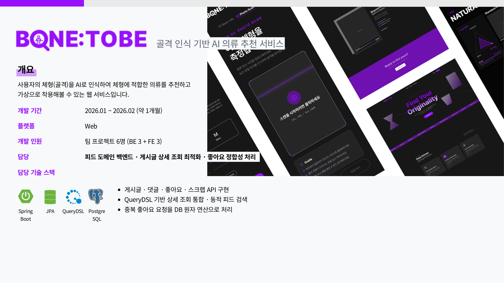
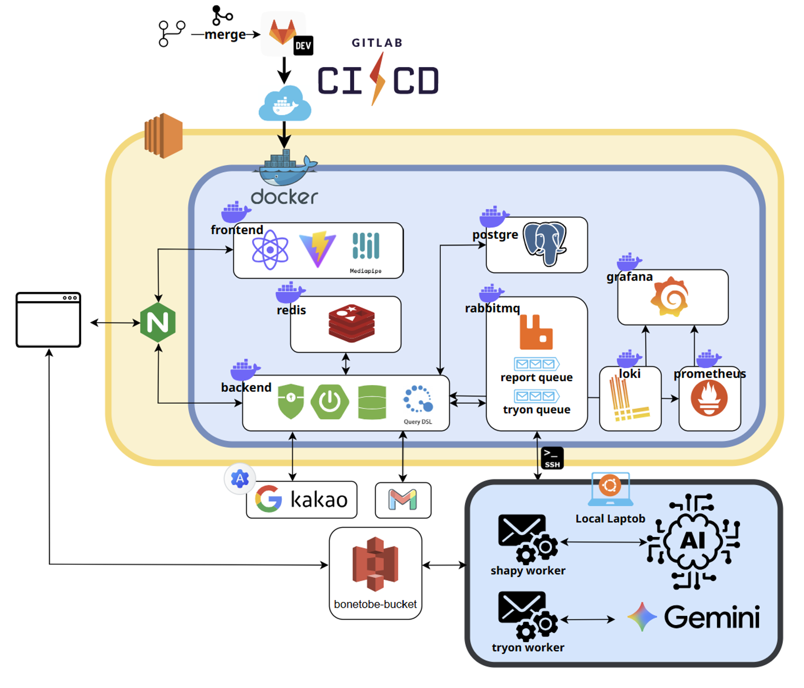
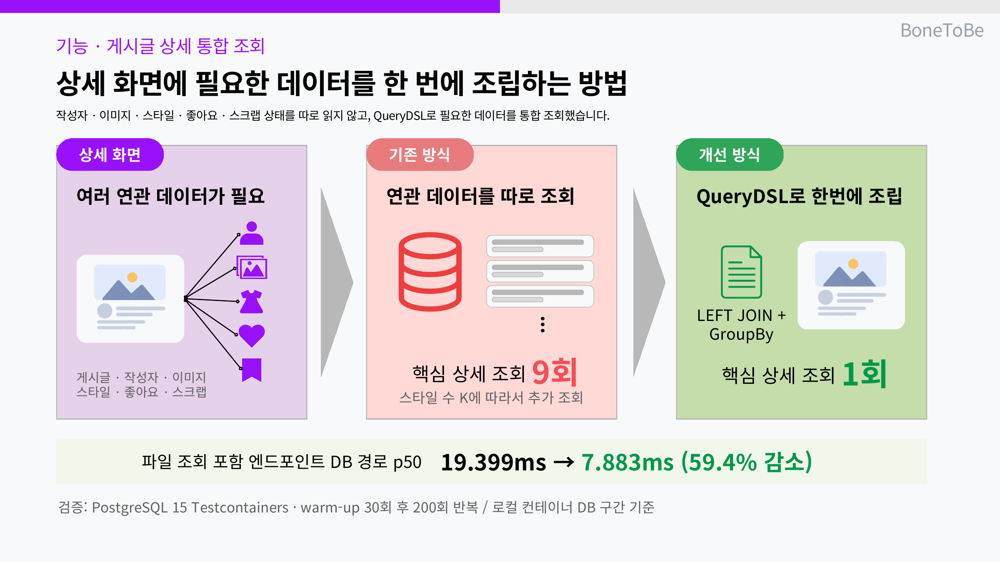
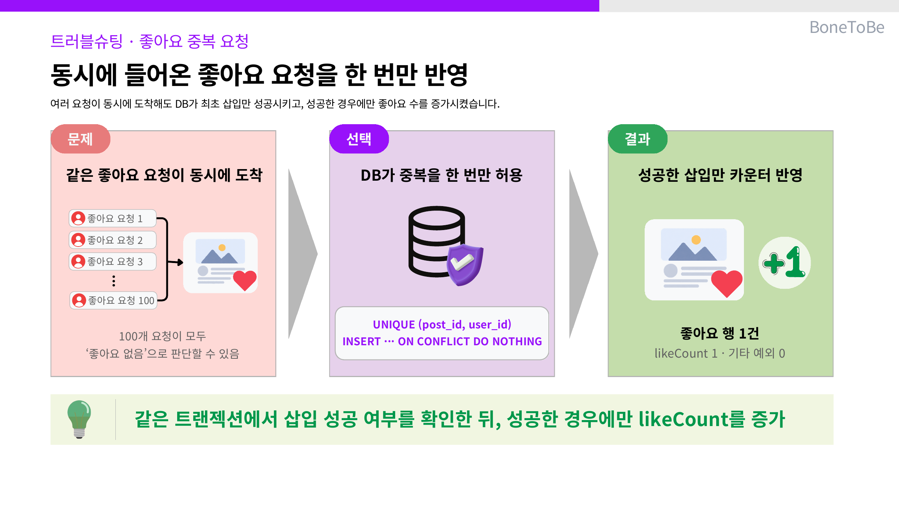

<h1 align="center">🦴 Bone To Be — AI 골격 인식 기반 의류 추천 서비스</h1>

<p align="center">
  사용자의 체형(골격)을 AI로 인식해 적합한 의류를 추천하고 <b>가상 착용(Try-On)</b>까지 제공하는 웹 서비스<br/>
  <em>Spring Boot 메인 서버와 FastAPI AI 서버를 RabbitMQ로 분리한 이벤트 기반 아키텍처</em>
</p>

<p align="center">
  
  
  
  
  
  
</p>

[화면 데모](https://bonetobe-demo.pages.dev/) · [포트폴리오 PDF](https://kr-uk.github.io/portfolio/portfolio-backend.pdf)



---

## 📌 프로젝트 개요

| 항목 | 내용 |
|:---:|---|
| **기간** | 2026.01 ~ 2026.02 (약 2개월) |
| **형태** | SSAFY 팀 프로젝트 (6인 · 백엔드 3명) |
| **한줄 소개** | AI 체형 인식으로 골격 유형을 판별하고 맞춤 의류를 추천·가상 착용하는 서비스 |

---

## 👥 담당 (김민욱)

> 이 레포는 **팀 전체 결과물**입니다. 아래가 제가 맡은 범위입니다.

### 맡은 것

| 영역 | 내용 |
|---|---|
| **커뮤니티 피드 도메인** | 게시글 CRUD · 댓글 · 좋아요(게시글/댓글) · 스크랩 · 유저 검색 |
| **게시글 상세 통합 조회** | QueryDSL `GroupBy.transform` + LEFT JOIN으로 N+1 제거 |
| **다중 조건 피드 검색** | QueryDSL `BooleanBuilder` 동적 쿼리 |
| **피드 이미지 업로드 연동** | 팀원이 구축한 S3 Presigned URL 인프라를 피드 도메인에 연동 (발급 엔드포인트 · 게시글 파일 라이프사이클) |
| **애플리케이션 메트릭** | Actuator · Micrometer · Prometheus · Grafana 컨테이너 구성 |

코드 위치: `backend/src/main/java/com/bonetobe/backend/post/` · `.../user/`

### 맡지 않은 것

- **AI 서버**(`shapy` 체형 인식 · `tryon` 가상 착용)와 **RabbitMQ 연동** — 다른 팀원
- **Loki · Promtail 로그 수집** — 다른 팀원 (제 범위는 메트릭 수집까지)
- **S3 Presigned URL 인프라**(`file/` 패키지 — `FileStorage` · `S3FileStoreImpl` · 발급 URL 모델) — 다른 팀원
  (제 범위는 이를 피드 도메인에서 소비하는 쪽입니다)
- **프론트엔드**(React · WebRTC) · **GitLab CI/CD 배포** — 다른 팀원

---

## 🛠️ 기술 스택

| 분류 | 기술 |
|:---:|---|
| **Backend** | Java 17 · Spring Boot 3.5.9 · Spring Data JPA · QueryDSL 5.0 · Spring AMQP(RabbitMQ) |
| **Storage** | AWS S3 — Presigned URL 업로드 |
| **AI Server** | FastAPI · MediaPipe Pose · 4D-Humans · PyTorch |
| **Database** | PostgreSQL · Redis |
| **Monitoring** | Prometheus · Grafana (메트릭) · Loki · Promtail (로그) |
| **Infra** | Docker · GitLab CI/CD · AWS EC2 · Nginx |

---

## 🏗️ 시스템 아키텍처



- **Spring Boot 메인 서버 ↔ FastAPI AI 서버**를 RabbitMQ로 분리
- 체형 분석 / Try-On 요청을 이벤트로 발행 → AI 서버가 비동기 처리 → 결과 큐로 회신
- AI 연산 지연을 사용자 응답 흐름에서 격리

> 이벤트 기반 분리 구조는 **팀 설계**이며, RabbitMQ 연동 구현은 다른 팀원이 담당했습니다.

---

## 🧱 피드 도메인 설계 (담당)

제 **첫 백엔드 프로젝트**였고, 여기서 처음으로 계층 분리와 의존성 역전을 적용했습니다.

```
post/
├── presentation/     PostController · ReplyController · PostLikeController · ScrapController
├── application/      PostFacade · ReplyFacade · PostLikeFacade · ScrapFacade
├── domain/           Post · Reply · PostLike · Scrap (엔티티)
│                     PostService     ← PostServiceImpl
│                     PostReader · PostStore · PostLikeReader · PostLikeStore   ← 인터페이스
└── infrastructure/   PostReaderImpl · PostStoreImpl · PostLikeReaderImpl · ScrapStoreImpl
                      PostJpaRepository · PostQueryDslRepositoryImpl · PostDetailQueryDslRepositoryImpl
```

**`domain`이 `Reader` / `Store` 인터페이스를 정의하고 `infrastructure`가 구현합니다.**
`application`의 Facade는 JPA도 QueryDSL도 모른 채 도메인 인터페이스만 봅니다.
조회(`Reader`)와 변경(`Store`)을 나눠, 복잡한 조회가 QueryDSL로 빠져나가도 변경 로직이 오염되지 않습니다.

### API

| 메서드 | 경로 | 설명 |
|:---:|---|---|
| `GET` | `/feeds` | 피드 목록 (정렬 · 페이징 · 다중 조건 필터) |
| `GET` | `/feeds/{feedId}` | 게시글 상세 |
| `POST` `PUT` `DELETE` | `/feeds` · `/feeds/{postId}` | 게시글 작성 · 수정 · 삭제 |
| `POST` | `/feeds/presigned-url` | 이미지 업로드용 서명 URL 발급 |
| `GET` | `/feeds/me` · `/feeds/liked` · `/feeds/scrapped` | 내 글 · 좋아요한 글 · 스크랩한 글 |
| `GET` | `/feeds/users/{userId}` | 특정 유저의 글 |

> 지금 다시 보면 같은 컨트롤러 안에서 `{feedId}`와 `{postId}`를 섞어 썼습니다.
> 리소스 이름을 하나로 통일했어야 했고, 이후 프로젝트에서는 **API 컨벤션을 코드보다 먼저
> 문서로 정하고 시작**하게 된 계기가 됐습니다
> ([DotShelf `patterns.md`](https://github.com/kr-Uk/dotshelf/blob/dev/backend/docs/architecture/patterns.md)).

---

## 🔧 트러블슈팅 & 기술적 의사결정

<details>
<summary><b>검증 결과 이미지로 보기</b></summary>

| 상세 조회 최적화 | 좋아요 동시성 검증 |
|---|---|
|  |  |

</details>

<details>
<summary><b>좋아요 동시성 — 버그를 기다리지 않고 첫 구현부터 막기</b></summary>

> 좋아요는 클릭 연타 · 네트워크 재시도 · 중복 전송이 일상인 엔드포인트입니다.
> `SELECT`로 존재를 확인한 뒤 `INSERT`하는 순차 처리는 두 요청이 동시에 `SELECT`하면
> 둘 다 "없음"으로 판단해 각자 `INSERT`를 시도하고, 중복 삽입이나 UNIQUE 위반 예외로 이어집니다.
>
> ```sql
> -- 삽입: Postgres 원자 연산 + UNIQUE 제약. 반환값(1/0)으로 중복 판별
> INSERT INTO post_like (post_id, user_id) VALUES (:postId, :userId)
> ON CONFLICT (post_id, user_id) DO NOTHING
>
> -- 카운터: 원자 갱신 + 언더플로우 방지
> UPDATE post SET like_count = like_count + :delta
> WHERE post_id = :postId AND (like_count + :delta) >= 0
> ```
>
> 방어가 실제로 동작하는지 확인하려고 **Testcontainers로 프로덕션과 같은 PostgreSQL을 띄우고**,
> 동일 사용자의 100개 동시 요청을 `CountDownLatch`로 정확히 같은 시점에 출발시켰습니다.
>
> | 지표 | 결과 |
> |---|---|
> | 실제 삽입된 행 | **1건** |
> | 중복 감지 | **99건** |
> | 기타 예외 | **0건** |
> | `like_count` | **정확히 1** |
>
> 애플리케이션 락 없이 DB 제약과 원자 연산만으로 정합성이 유지됨을 확인했습니다.
>
> **한계** — 인기 게시글에서는 카운터 행에 락이 몰립니다. 트래픽이 커지면 Redis 카운터 +
> 주기적 flush나 샤딩 카운터가 필요합니다. 현재 규모에서는 정합성을 우선했습니다.
</details>

<details>
<summary><b>게시글 상세 조회 — 개별 조회 대조 구현과 QueryDSL 통합 조회 비교</b></summary>

> 상세 조회 하나에 Post · 작성자 · 프로필 이미지 · 게시글 이미지 · 스타일 태그 ·
> 조회자의 좋아요/스크랩 여부까지 여러 도메인이 필요합니다. JPA 기본 방식이면 연관 관계마다
> 개별 쿼리가 나가고, `PostStyle`에서 `Style`을 지연 로딩하면서 **스타일 개수 K만큼 쿼리가 더 붙어
> (7+K)회로 선형 증가**합니다.
>
> QueryDSL `GroupBy.transform` + LEFT JOIN으로 통합 조회하고, 조회자의 좋아요/스크랩 여부는
> `on(...)` 조건 JOIN으로 함께 처리해 **1 쿼리**로 줄였습니다.
> 컬렉션이 곱해지며 행이 불어나는 건 `transform`의 `groupBy`로 접었습니다.
>
> | 지표 | 개별 조회 대조 구현 | QueryDSL 통합 조회 |
> |---|:---:|:---:|
> | 핵심 상세 조회 쿼리 수 | 9회 | **1회** (88.9% 감소) |
> | 파일 조회 포함 엔드포인트 DB 경로 | 9회 | **3회** |
> | 엔드포인트 DB 경로 p50 | 19.399ms | **7.883ms** (59.4% 감소) |
> | 스타일 K개일 때 | (7+K)회 | **핵심 조회 1회 고정** |
>
> 실제 상세 조회는 처음부터 QueryDSL로 구현했습니다. 왼쪽 수치는 비교를 위해 작성한 개별 조회 대조 구현입니다.
>
> 기존 단발 측정에서는 41ms → 142ms로 통합 조회가 더 느리게 나와 실행 순서와 초기화 비용의
> 영향을 크게 받았습니다. 이를 보완해 PostgreSQL 15 Testcontainers에서 warm-up 30회 후
> 200회 반복 측정했고, 파일 조회를 포함한 엔드포인트 DB 경로의 p50이
> **19.399ms → 7.883ms(59.4% 감소)**로 확인됐습니다.
>
> 이 수치는 소량 시드·로컬 컨테이너의 DB 구간 기준이며 HTTP 처리와 URL 서명 시간은 제외했습니다.
> 운영 규모 데이터와 실제 네트워크 환경에서는 추가 검증이 필요합니다.
>
> 행 폭증에 대한 한계도 있습니다 — 이미지와 스타일이 각각 M·K개면 M×K행이 내려옵니다.
> 개수가 커지면 컬렉션 하나는 별도 배치 조회로 빼는 게 맞습니다.
</details>

<details>
<summary><b>S3 Presigned URL — 백엔드를 파일 데이터 경로에서 빼기</b></summary>

> `MultipartFile` 방식은 파일 전량을 백엔드가 수신 → 임시 저장 → S3로 재전송합니다.
> **백엔드가 파일 이동 경로에 항상 포함**되므로 파일 크기만큼 CPU · 메모리 · 대역폭을 씁니다.
>
> ```
> [개선 전]  Client ──파일──> Backend ──파일──> S3
> [개선 후]  Client <─URL── Backend
>            Client ──────파일──────> S3
>            Client ──메타데이터──> Backend
> ```
>
> 백엔드가 처리하는 파일 데이터는 **0 bytes**, 응답은 짧은 URL 문자열뿐입니다.
>
> 다만 "URL만 받고 실제 업로드는 안 한" orphan 파일이 남을 수 있어, 파일 상태를
> `REQUESTED`(발급) → `UPLOADED` → `CONFIRMED`로 추적하도록 설계했습니다.
> 업로드 완료 처리 시 **소유자 검증**을 거쳐 권한 없는 파일 확정을 차단합니다.
>
> **한계** — 클라이언트가 `UPLOADED` 콜백을 보내지 않으면 S3에 참조되지 않는 객체가 남습니다.
> S3 라이프사이클 규칙이나 정리 배치가 필요하고, 현재는 미구현입니다.
</details>

<details>
<summary><b>다중 조건 피드 검색 — QueryDSL 동적 쿼리</b></summary>

> 스타일 · 성별 · 체형 타입 등 선택적 필터 조합을 정적 SQL로 처리하면 분기가 폭발합니다.
> QueryDSL `BooleanBuilder`로 조건을 동적 조립해 단일 쿼리로 처리했습니다.
> 각 필터는 값이 `null`이면 조건을 추가하지 않는 방식이라, 조합 수가 늘어도 코드는 그대로입니다.
</details>

<details>
<summary><b>애플리케이션 메트릭 수집 환경</b></summary>

> Actuator + Micrometer로 애플리케이션 메트릭(JVM · HTTP · 커넥션 풀)을 노출하고,
> Prometheus 수집 + Grafana 시각화 컨테이너를 `docker-compose`에 추가했습니다.
> Grafana는 `127.0.0.1`에만 바인드하고 익명 접근·회원가입을 비활성화했습니다.
>
> 제 범위는 **메트릭 수집까지**이며, 팀 배포 스택의 Loki · Promtail 로그 수집은 다른 팀원이 구성했습니다.
</details>

---

## 🚀 실행

```bash
docker compose up -d          # PostgreSQL · Redis · RabbitMQ · Prometheus · Grafana
cd backend && ./gradlew bootRun
                              # Swagger: /swagger-ui.html
```

배포 스택 전체 구성은 [`exec/빌드 배포 가이드라인.md`](exec/빌드%20배포%20가이드라인.md)를 참고하세요.

---

## 📝 회고

첫 백엔드 프로젝트였고, 남은 것은 세 가지입니다.

1. **계층을 나누는 이유를 몸으로 알게 됐습니다.** 처음엔 Facade와 Service가 왜 둘 다 필요한지
   몰랐는데, 복잡한 조회가 QueryDSL로 빠지면서 조회/변경을 나눠둔 게 실제로 도움이 됐습니다.
2. **동시성은 나중에 고치는 게 아니라 처음부터 막는 것**이라는 걸 배웠습니다.
   `ON CONFLICT`를 먼저 쓰고 나중에 Testcontainers로 검증한 순서가 맞았습니다.
3. **컨벤션은 코드보다 먼저 정해야 합니다.** `{feedId}`/`{postId}`가 섞인 걸 뒤늦게 발견하고,
   다음 팀 프로젝트에서는 아키텍처 규약 문서를 프로젝트 첫날에 작성했습니다.
